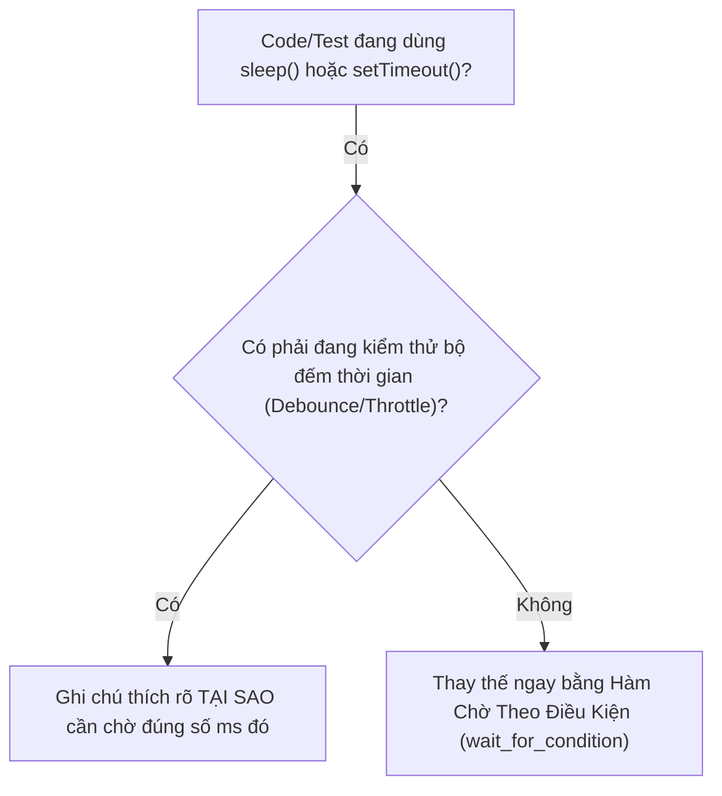

# Kỹ Thuật Chờ Theo Điều Kiện Thực Tế (`Condition-Based Waiting — version.4.4.0.0`)

## 1. Tổng Quan (`Overview`)
Các bài kiểm thử chập chờn (`Flaky Tests`) hoặc kịch bản tự động hóa giao diện thường đoán mò thời gian chờ bằng các hàm ngủ cố định (`time.sleep(2)`, `setTimeout(..., 500)`, `Start-Sleep`). Cách làm này gây ra lỗi tranh chấp luồng (`Race Condition`): chạy mượt khi máy rảnh nhưng báo lỗi ngẫu nhiên khi CPU Xeon 24 luồng đang chạy tải nặng hoặc khi ứng dụng phản hồi chậm hơn dự kiến.

> **Nguyên lý cốt lõi (`Core Principle`):** Hãy chờ **ĐIỀU KIỆN THỰC TẾ (`Actual Condition`)** mà bạn cần hoàn tất, tuyệt đối không đoán mò mất bao nhiêu mili-giây.

---

## 2. Sơ Đồ Quyết Định (`When to Use`)



**Khi nào áp dụng trên máy Windows 10/11:**
- Khi điều khiển cửa sổ phần mềm bằng MCP **`windows-mcp`**: Luôn gọi công cụ `WaitFor` (chờ cửa sổ/phần tử UI xuất hiện) thay vì dùng `Wait` cố định mù quáng.
- Khi kiểm thử trình duyệt bằng **`chrome-devtools-mcp` / `browsentic`**: Dùng `wait_for` / `page_waitForElement` thay vì ngủ cứng.
- Khi viết code Python / TypeScript bất đồng bộ: Dùng hàm `wait_for_condition` kiểm tra chu kỳ `10ms`.

---

## 3. Mẫu Triển Khai Chuẩn (`Production Implementation`)

### 🐍 Bản Python Chuẩn (Dành cho Backend / Automation trên máy Antidv)
```python
import time
from typing import Callable, TypeVar

T = TypeVar("T")

def wait_for_condition(
    condition: Callable[[], T],
    description: str,
    timeout_sec: float = 5.0,
    poll_interval_sec: float = 0.01,  # Kiểm tra mỗi 10ms — tối ưu cho CPU Xeon 24 luồng
) -> T:
    """
    Chờ cho đến khi hàm `condition()` trả về giá trị khác None/False.
    Ném lỗi TimeoutError rõ ràng nếu quá thời gian `timeout_sec`.
    """
    start_time = time.perf_counter()
    while True:
        result = condition()
        if result:
            return result
        if (time.perf_counter() - start_time) > timeout_sec:
            raise TimeoutError(
                f"[TIMEOUT] Quá thời gian chờ ({timeout_sec * 1000:.0f}ms) cho điều kiện: {description}"
            )
        time.sleep(poll_interval_sec)
```

### 📘 Bản TypeScript Chuẩn (Dành cho React / Node.js / Playwright)
```typescript
// ❌ CÁCH SAI: Đoán mò thời gian chờ 300ms
// await new Promise(r => setTimeout(r, 300));
// expect(getResult()).toBeDefined();

// ✅ CÁCH ĐÚNG: Chờ điều kiện thực tế hoàn thành
export async function waitFor<T>(
  condition: () => T | undefined | null | false,
  description: string,
  timeoutMs = 5000
): Promise<T> {
  const startTime = Date.now();
  while (true) {
    const result = condition();
    if (result) return result;
    if (Date.now() - startTime > timeoutMs) {
      throw new Error(`Quá thời gian chờ (${timeoutMs}ms) cho điều kiện: ${description}`);
    }
    await new Promise((r) => setTimeout(r, 10)); // Kiểm tra mỗi 10ms
  }
}
```

---

## 4. Ba Sai Lầm Thường Gặp Cần Tránh (`Common Mistakes`)
1. **Kiểm tra quá dày (`Polling 1ms` hoặc vòng lặp `while True` không có `sleep`):** Gây ngốn 100% luồng CPU vô ích ➔ **Giải pháp:** Đặt chu kỳ kiểm tra `10ms` (`0.01s`).
2. **Không có ngưỡng dừng (`No Timeout`):** Treo vĩnh viễn nếu điều kiện không bao giờ xảy ra ➔ **Giải pháp:** Luôn có `timeout_sec` kèm thông báo lỗi tiếng Việt rõ ràng.
3. **Đọc dữ liệu cũ ngoài vòng lặp (`Stale Data`):** Lưu biến trạng thái trước khi vào vòng lặp `while` ➔ **Giải pháp:** Luôn gọi hàm lấy trạng thái mới nhất bên trong hàm `condition()`.
