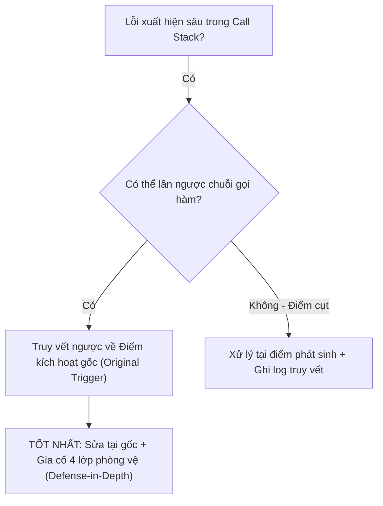

# Kỹ Thuật Truy Vết Nguyên Nhân Gốc Rễ (`Root Cause Tracing — version.4.4.0.0`)

## 1. Tổng Quan (`Overview`)
Lỗi phần mềm thường phát nổ ở tầng rất sâu trong chuỗi gọi hàm (`Call Stack`) — ví dụ: lệnh `git init` chạy nhầm thư mục, tệp tin được tạo sai đường dẫn Windows, hoặc kết nối cơ sở dữ liệu mở nhầm tệp rỗng. Bản năng thông thường là sửa ngay tại dòng báo lỗi, nhưng đó chỉ là **chữa triệu chứng ngọn (`Treating a Symptom`)**.

> **Nguyên lý cốt lõi (`Core Principle`):** Lần ngược lên theo chuỗi gọi hàm (`Trace backward through the call chain`) kết hợp công cụ MCP `code-graph` (`get_call_graph`, `find_references`) cho đến khi tìm ra **điểm kích hoạt ban đầu (`Original Trigger`)**, sau đó sửa tận gốc tại nguồn phát sinh.

---

## 2. Sơ Đồ Quyết Định Khi Nào Áp Dụng (`When to Use`)



**Áp dụng ngay khi:**
- Lỗi xảy ra sâu bên trong quá trình thực thi (không phải ngay ở hàm đầu vào).
- `Stack Trace` hiển thị chuỗi gọi hàm dài qua nhiều lớp (`UI ➔ Controller ➔ Service ➔ Repository`).
- Không rõ dữ liệu rỗng (`null`, `None`, `""`) hoặc sai định dạng xuất phát từ đâu.
- Cần tìm xem bài test hoặc tiến trình nào đã làm hỏng dữ liệu chung.

---

## 3. Quy Trình 5 Bước Truy Vết Ngược (`The 5-Step Tracing Process`)

### Bước 1: Quan sát triệu chứng lỗi (`Observe the Symptom`)
```text
Error: FileNotFoundError / git init failed in ~\project\core
```

### Bước 2: Tìm nguyên nhân trực tiếp (`Find Immediate Cause`)
**Đoạn code nào trực tiếp gọi lệnh gây nổ lỗi?**
```typescript
await execFileAsync('git', ['init'], { cwd: projectDir });
```

### Bước 3: Đặt câu hỏi — Hàm nào đã gọi hàm này? (`Ask: What Called This?`)
Sử dụng MCP `code-graph` (`get_call_graph` hoặc `find_references`):
```text
WorktreeManager.createSessionWorktree(projectDir, sessionId)
  ↑ được gọi bởi Session.initializeWorkspace()
  ↑ được gọi bởi Session.create()
  ↑ được gọi bởi bài test tại Project.create()
```

### Bước 4: Tiếp tục lần ngược lên trên (`Keep Tracing Up`)
**Giá trị thực tế được truyền vào là gì?**
- `projectDir = ''` (chuỗi rỗng!).
- Chuỗi rỗng khi truyền vào `cwd` sẽ tự động trỏ về thư mục hiện tại `process.cwd()` (chính là thư mục mã nguồn gốc!).

### Bước 5: Tìm điểm kích hoạt ban đầu (`Find Original Trigger`)
**Chuỗi rỗng đó xuất phát từ đâu?**
```typescript
const context = setupCoreTest(); // Trả về { tempDir: '' } trước khi vào hàm beforeEach!
Project.create('name', context.tempDir); // Truy cập quá sớm trước khi beforeEach kịp khởi tạo!
```
➔ **Cách sửa tận gốc:** Biến `tempDir` thành một `getter` tự động báo lỗi rõ ràng nếu bị truy cập trước khi `beforeEach` chạy xong.

---

## 4. Kỹ Thuật Chèn Log Truy Vết (`Adding Stack Trace Instrumentation`)

Khi không thể nhìn bằng mắt thường, hãy chèn log ghi lại `Stack Trace` ngay **TRƯỚC** thao tác nguy hiểm:

```python
# Ví dụ bằng Python (chuẩn UTF-8 trên Windows 10/11):
import os, sys, traceback

def safe_init_workspace(directory: str) -> None:
    # Ghi log chẩn đoán ra stderr (không bị nuốt bởi test runner)
    stack_str = "".join(traceback.format_stack(limit=6))
    sys.stderr.write(
        f"[DEBUG TRACE] Chuẩn bị khởi tạo tại: directory={directory!r}, "
        f"cwd={os.getcwd()!r}\nStack:\n{stack_str}\n"
    )
    # Thực thi thao tác...
```

**Mẹo quan trọng khi chạy Test:**
- Luôn ghi ra `sys.stderr` (Python) hoặc `console.error()` (Node.js/TypeScript) thay vì `logger.info` thông thường vì bộ chạy test thường ẩn log chuẩn.
- Nếu có một bài test nào đó tạo ra file rác hoặc làm bẩn trạng thái chung mà chưa rõ là bài test nào, hãy chạy script cô lập [`find-polluter.ps1`](file:///~/.gemini/config/skills/systematic-debugging/find-polluter.ps1) ngay trong thư mục kỹ năng này.
